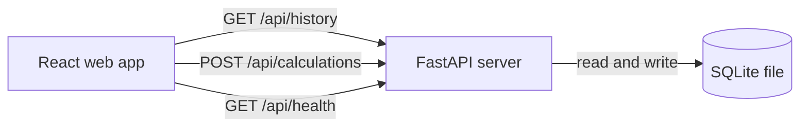

# Design: SQLite API Calculator

## Overview

A small calculator web app for one User who never signs in. The browser shows a calculator screen (a display above a keypad) and a history list of past calculations. A Python API does the arithmetic, saves every successful calculation to SQLite, and serves the history. React renders the screens.

The stack is the one the User picked: React for the web app, Python for the API, SQLite for the saved calculations.

## Architecture

Two processes in development and one in production:

- **Web app** — React built with Vite, served by Vite's dev server on the port Greenfield sets. It calls the API under `/api` and Vite proxies those requests to the API server.
- **API** — Python with FastAPI, run with Uvicorn. It owns the SQLite file, does the arithmetic, saves calculations and answers the health check.
- **Database** — one SQLite file, created by the API on startup from the schema in `server/db.py`. No database server to start.



In development the browser talks to Vite, and Vite forwards `/api` to the API. In production the API serves the built React files itself, so one process answers everything on one port.

## Components and Interfaces

### API

| Method | Path | Body | Response |
| --- | --- | --- | --- |
| `POST` | `/api/calculations` | `{"left": 7, "operator": "×", "right": 8}` | `201` with the saved calculation, or `400` with `{"error": "Division by zero is not allowed"}` |
| `GET` | `/api/history` | — | `200` with the saved calculations, newest first |
| `GET` | `/api/health` | — | `200` with `{"status": "ok"}` |

A saved calculation is returned as:

```json
{
  "id": 12,
  "expression": "7 × 8",
  "result": 56,
  "created_at": "2026-11-01T08:15:00+00:00"
}
```

- `operator` is one of `+`, `−`, `×`, `÷`. Any other value is refused with `400`.
- `left` and `right` are numbers. A body that is not two numbers is refused with `400`.
- Division by zero is refused with `400` and nothing is written.
- The API stores the time in UTC; the web app shows it in the User's local time zone.
- The API serves the built React files from `web/dist` at `/` when that folder exists, so production runs as one process.

### Web app

- `CalculatorScreen` — the display, the keypad (digits 0 to 9, `.`, `+`, `−`, `×`, `÷`, `=`, `C`) and the message line. It keeps the first number, the chosen operator and the second number in state, and calls the API on `=`.
- `HistoryList` — the saved calculations, newest first, each row showing the expression, the result and the local time. It shows "Calculation not saved" beside the list when a save fails.
- `api.js` — the two calls to the API, `saveCalculation` and `loadHistory`.
- `App` — lays the calculator and the history list out side by side on a desktop and one above the other on a phone.

## Data Models

One table, created on startup:

```sql
CREATE TABLE IF NOT EXISTS calculations (
  id INTEGER PRIMARY KEY AUTOINCREMENT,
  expression TEXT NOT NULL,
  result REAL NOT NULL,
  created_at TEXT NOT NULL
);
```

- `expression` is the calculation as the User sees it, such as `7 × 8`.
- `result` is the number shown on the display.
- `created_at` is an ISO 8601 timestamp in UTC.
- The history is read with `ORDER BY id DESC`, so the newest calculation is first.

## Error Handling

- **Division by zero** — the API answers `400` with "Division by zero is not allowed"; the web app shows that message on the display and saves nothing.
- **A body that is not two numbers or a known operator** — the API answers `400`; the web app shows a hint to enter a number and keeps the display as it was.
- **A save that fails** — the web app still shows the result and shows "Calculation not saved" beside the history list.
- **A history read that fails** — the web app shows an empty history list with the message "History could not be loaded".
- **A missing SQLite file** — the API creates it and its table on startup.

## Testing Strategy

- **API tests** with `pytest` and FastAPI's `TestClient`, each test pointing the app at a SQLite file in a temporary folder that it creates and removes. They cover the four operations, division by zero, a bad body, the saved row and the history order.
- **Web app tests** with `vitest` and React Testing Library, with the API calls mocked. They cover the keypad, the display, the four worked examples, the clear button, the division-by-zero message and the history rows.
- **End-to-end journeys** with `@playwright/test` in `e2e/`, run only through `run_journeys` against the running app.

## Build and run
Install: npm install
Test: npm test
Run locally: yes
Dev: npm run dev
Port variable: PORT
Health path: /api/health
Deploy: local-server

`npm install` installs the web app's packages and the Python API's packages into `server/.venv`. `npm test` runs the API tests with pytest and the web app tests with vitest once each and exits. `npm run dev` creates the SQLite file if it is missing, starts the API on a port it picks, and starts Vite on `PORT`, which forwards `/api` to the API.

## Look and feel

A clean, modern calculator: a light page, a white surface for the calculator and the history, a calm blue for the main action, and generous spacing.

- **Colours** — background `#f4f6fb`, surface `#ffffff`, text `#1f2937`, muted text `#6b7280`, primary `#2563eb`, primary hover `#1d4ed8`, error `#dc2626`, success `#16a34a`, border `#e5e7eb`.
- **Font** — `Inter, system-ui, -apple-system, "Segoe UI", sans-serif`. The display uses tabular figures at 40px on a desktop and 32px on a phone.
- **Spacing** — a 4px scale: 8, 12, 16, 24 and 32px. The page has 24px padding on a phone and 40px on a desktop.
- **Corner radius** — 12px for cards and buttons, 16px for the calculator card.
- **Buttons** — digit buttons are white with a `#e5e7eb` border and dark text; operator buttons are light blue `#dbeafe` with `#1e40af` text; the equals button is the primary blue with white text; the clear button is white with error-coloured text. Every button is at least 48px tall, has a 150ms colour transition, darkens on hover, shows a 2px primary focus ring on keyboard focus, and shrinks slightly on press. A disabled button is at 50% opacity with no hover change.
- **Fields** — the display is a read-only surface with a border, right-aligned text and 16px padding. The message line under it is muted text, in the error colour when it shows a problem.
- **Lists** — the history is a list of rows separated by 1px borders, each row with the expression on the left and the result and time on the right in muted text. Rows alternate no colour; the newest row sits at the top.

### Calculator screen on a desktop

The page centres a two-column layout, at most 960px wide: the calculator card on the left (about 360px) and the history card on the right, filling the rest. The calculator card holds the display at the top, the message line under it, and a 4-column keypad below: `C`, `÷`, `×`, `−` on the first row, then `7 8 9 +`, `4 5 6` with `=` spanning two rows on the right, and `1 2 3` and `0 .` on the last rows.

### Calculator screen on a phone

The page stacks the calculator card above the history card, both full width with 16px between them. The keypad keeps its 4-column grid with buttons at least 56px tall, so each digit is easy to tap. The history card sits below and scrolls with the page.

## Assumptions

- The API is Python with FastAPI and Uvicorn, and the web app is React with Vite, since the brief names React, Python and SQLite but no framework.
- The web app is a single page: the calculator and the history list are on it together, as the brief's one-screen calculator and its history list describe.
- The API does the arithmetic and saves the calculation in one request, so the result and the saved row always agree.
- The history has no limit and no delete control, as the requirements assume.
- The app has no sign-in and no settings, since the brief says the User never signs in and no administration screens are needed.
- The app is deployed on the User's local server, so `Deploy:` is `local-server`: the deployment setup writes what that server needs to build and run the app there, and does not deploy it.
